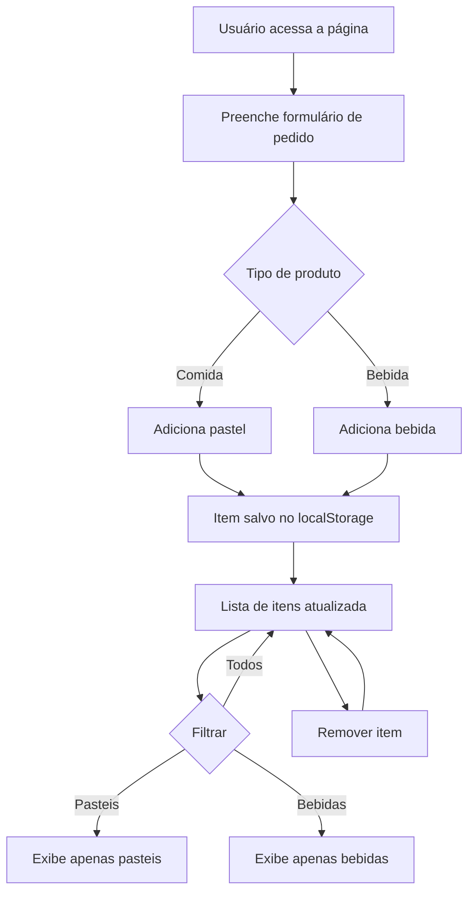

# Como iniciar a aplicação
**Quer acessar a aplicação?**

[https://pastelaria88.firebaseapp.com/](https://pastelaria88.firebaseapp.com/)

Abra o terminal 
Verifique se você possui node e npm instalados

```bash
node --version
```
```bash
npm --version
```

Verifique ou instale o Vue CLI
> check version
```bash
vue --version
```
> install
```bash
npm install -g @vue/cli
```
Clone o projeto para sua maquina e acesse a pasta após clonar

```git
git clone https://github.com/brunocbcsilva/pastelaria.git
cd pastelaria
````
Dentro da pasta `pastelaria` execute o comando abaixo
```bash
npm install
```
Após a instalação dos pacotes execute o comando
```bash
npm run serve
````
# Sobre o projeto

O sistema **Pastelaria** é uma aplicação web feita com Vue.js para gerenciar pedidos de uma pastelaria. O usuário pode cadastrar, visualizar, filtrar e remover itens do cardápio, separados entre comidas (pasteis) e bebidas.

## Principais funcionalidades
- Cadastro de pedidos (pasteis e bebidas)
- Listagem dos itens cadastrados
- Filtros por tipo de produto
- Remoção de itens
- Persistência local dos dados (localStorage)
- Interface responsiva e moderna

## Estrutura dos componentes
- **App.vue**: Componente principal, gerencia o fluxo da aplicação e exibe os demais componentes.
- **HeaderPage.vue**: Cabeçalho visual da página.
- **FormPedidos.vue**: Formulário para cadastro de novos itens no cardápio.
- **MediaList.vue**: Lista visual dos itens cadastrados, com opção de remover.
- **Modal.vue**: Modal para interações (edição, confirmação, etc).
- **store.js**: Gerenciamento centralizado do estado (Vuex), incluindo lista de itens e controle de modal.

## Fluxo principal do sistema



## Como funciona
1. O usuário acessa a página e vê o cabeçalho.
2. Preenche o formulário para adicionar um novo item (pastel ou bebida).
3. O item é salvo e aparece na lista.
4. É possível filtrar a lista por tipo de produto.
5. O usuário pode remover itens do cardápio.

## Tecnologias utilizadas
- Vue.js
- Vuex
- SCSS
- Parallax.js
- LocalStorage

## Estrutura de pastas
```
public/
  index.html
src/
  App.vue
  main.js
  store.js
  assets/
  components/
    FormPedidos.vue
    HeaderPage.vue
    MediaList.vue
    Modal.vue
  styles/
    _geral.scss
    _layout.scss
    _mixins.scss
    _reset.scss
    _variables.scss
    pastelaria.scss
```

---
Se precisar de mais detalhes sobre algum componente ou fluxo, só pedir!
