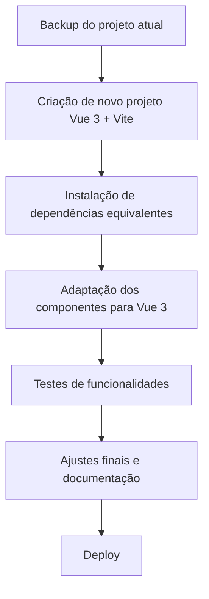

# Plano de Atualização: Vue 2 para Vue 3 + Vite

Este documento apresenta um planejamento detalhado para migrar a aplicação Pastelaria de Vue 2 (com Vue CLI) para Vue 3 utilizando Vite como bundler. O objetivo é modernizar o projeto, melhorar performance, facilitar manutenção e aproveitar os recursos do Vue 3.

---

## 1. Análise Inicial
- Revisar dependências atuais e identificar incompatibilidades.
- Mapear componentes, plugins e integrações que exigem atualização.
- Verificar uso de APIs obsoletas do Vue 2.

## 2. Passos Gerais da Migração



---

## 3. Detalhamento das Etapas

### 3.1. Backup e Preparação
- Realizar backup completo do projeto atual.
- Documentar principais funcionalidades e fluxos.

### 3.2. Criação do Novo Projeto
- Utilizar o comando:
  ```bash
  npm create vite@latest pastelaria-vue3 -- --template vue
  ```
- Estruturar pastas conforme o projeto original.

### 3.3. Instalação de Dependências
- Instalar Vue 3, Vuex (ou Pinia), Bootstrap (versão compatível), SCSS, Parallax.js, etc.
- Verificar plugins e buscar versões compatíveis ou alternativas para Vue 3.

### 3.4. Adaptação dos Componentes
- Refatorar componentes para sintaxe Vue 3 (Composition API ou Options API).
- Ajustar importação e uso de plugins.
- Atualizar diretivas e ciclo de vida.
- Migrar store para Pinia (recomendado) ou Vuex 4.

### 3.5. Testes
- Testar cada funcionalidade migrada.
- Validar integração com localStorage, filtros, modais, etc.

### 3.6. Ajustes Finais
- Corrigir problemas de lint, warnings e compatibilidade.
- Atualizar README e documentação técnica.

### 3.7. Deploy
- Realizar build de produção com Vite.
- Testar deploy em ambiente real.

---

## 4. Pontos de Atenção
- Plugins que não possuem suporte ao Vue 3.
- Mudanças na estrutura do Vuex/Pinia.
- Sintaxe de diretivas e ciclo de vida.
- Adaptação dos estilos SCSS.

---

## 5. Sugestão de Estrutura Final
```
pastelaria-vue3/
  public/
  src/
    assets/
    components/
    store/
    styles/
    App.vue
    main.js
  docs/
  README.md
```

---

## 6. Referências
- [Guia oficial de migração Vue 2 → Vue 3](https://v3-migration.vuejs.org/)
- [Documentação Vite](https://vitejs.dev/)
- [Pinia - State Management](https://pinia.vuejs.org/)

---

Se desejar um roteiro mais detalhado para cada componente ou integração, só pedir!